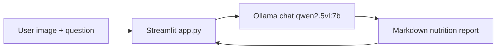

# AI Nutrition Coach

## Purpose

A **Streamlit** app that accepts a **food image** and an optional question, then uses a **local vision-language model through Ollama** to estimate items, portions, calories, and nutrients. Outputs are explicitly approximate (disclaimer in the prompt).

---

## Problem Statement

Users want quick, private meal feedback without sending photos to a cloud API. This project demonstrates **multimodal chat** with Ollama’s native `ollama.chat` API and image bytes in the message payload.

---

## Features (Implemented)

- Upload JPG/JPEG/PNG food images.
- Optional natural-language question (default: calorie and nutrition analysis).
- Structured markdown-style sections: identification, portions, calories, nutrients, health evaluation, disclaimer.
- Local inference via **`qwen2.5vl:7b`** with expanded context (`num_ctx: 8192`).

**Not implemented:** database logging, user accounts, medical validation, or calorie lookup from a fixed nutrition API.

---

## Technologies and Architecture

| Layer | Technology |
|-------|------------|
| UI | Streamlit |
| Vision + LLM | Ollama Python SDK, model `qwen2.5vl:7b` |
| Input | Image bytes attached to user message |



---

## Project Structure

```text
AI_NUTRITION_Coach/
└── app.py    # Streamlit UI + ollama.chat with images
```

---

## Prerequisites

- Python 3.10+
- [Ollama](https://ollama.com/) with **`qwen2.5vl:7b`** pulled
- Packages: `streamlit`, `ollama`

```bash
ollama pull qwen2.5vl:7b
pip install streamlit ollama
```

---

## Installation and Configuration

No `.env` file is required by the code. Ollama defaults to `http://127.0.0.1:11434`. Configure Ollama externally if you use a remote host.

---

## How to Run

```bash
cd AI_NUTRITION_Coach
streamlit run app.py
```

1. Enter a question (optional).
2. Upload a food image.
3. Click **Analyze Food**.

On success, **Nutrition Analysis** renders the model’s markdown answer. On failure, Streamlit shows the Ollama error string.

---

## Code Walkthrough

- **`ollama.chat`**: unlike LangChain examples elsewhere, this app uses the **`ollama`** package directly with `messages[].images` set to raw bytes.
- **Prompt template**: fixed section headings guide consistent output without a parser.
- **Error handling**: broad `try/except` around the Ollama call for UI feedback.

---

## Example Usage

- Question: “How many calories are in this meal?”
- Expected: narrative estimates per section, not verified against USDA or label data.

---

## Troubleshooting and Limitations

- **Model not found**: Run `ollama pull qwen2.5vl:7b`.
- **VRAM / speed**: Vision models are heavier than `llama3.1:8b`; CPU-only setups may be slow.
- **Accuracy**: Vision LLMs can misidentify foods; not suitable for medical or dietary compliance decisions.
- **No API keys in repo**: all inference is local via Ollama.

---

## Related Learning Modules

- [Multimodal Generative AI](../MultiModalGenAI/README.md)
- [Foundations of GenAI](../FoundationsOfGenAIAndPromptEng/README.md)

---

## Possible Future Improvements (Not in Repo)

- Nutrition lookup from a structured database after food identification.
- Portion calibration using reference objects.
- Save history locally with user consent.
