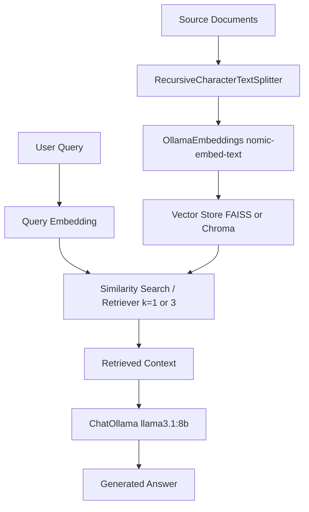

# Module 3: Advanced RAG Concepts

## Module Overview

Two scripts progress from **low-level FAISS search** to a **LangChain retriever + LLM** pipeline over **Chroma**, including **document chunking** and **context-only** answering, core RAG patterns used in the PDF and YouTube projects.

Prerequisites: [Module 2](../VectorDatabasesForRAG/README.md).

---

## Learning Objectives

- Index document embeddings in **FAISS** and query by L2 distance.
- Split documents with `RecursiveCharacterTextSplitter`.
- Store chunks in **Chroma** and retrieve with `as_retriever`.
- Ground LLM answers in retrieved context via a manual prompt (retriever script).

---

## Concepts Covered

### Semantic search with FAISS

**`FAISS_semantic_similarity.py`**: embeds sample paragraphs with `OllamaEmbeddings`, builds `IndexFlatL2`, searches top-`k` neighbors for a natural-language query.

### Chunking

**Why:** LLMs and retrievers work on limited context; policies and docs are split into overlapping chunks.  
**How:** `chunk_size=500`, `chunk_overlap=50` in `langchain_retriever.py`.

### Retriever + generation

**`langchain_retriever.py`**: HR policy `Document` objects → chunks → Chroma collection `company_policies` → `retriever.invoke(query)` → context stuffed into a prompt → `ChatOllama` response. This is RAG without the higher-level `create_retrieval_chain` helper (that appears in PDF_QA_Bot).

---

## Architecture and Workflow



---

## Project Structure

```text
AdvancedRAGConcepts/
├── FAISS_semantic_similarity.py   # FAISS IndexFlatL2 + search()
└── langchain_retriever.py         # Chroma + retriever + prompt Q&A
```

---

## Prerequisites

- Ollama: `llama3.1:8b`, `nomic-embed-text`.
- Packages: `langchain-ollama`, `langchain-chroma`, `langchain-text-splitters`, `langchain-core`, `faiss-cpu`, `numpy`.

---

## Installation and Setup

```bash
cd AdvancedRAGConcepts
pip install langchain-ollama langchain-chroma langchain-text-splitters langchain-core faiss-cpu numpy
ollama pull llama3.1:8b
ollama pull nomic-embed-text
```

---

## How to Run

```bash
python FAISS_semantic_similarity.py
```

Prints ranked documents for: `"How do computers learn from information?"`

```bash
python langchain_retriever.py
```

Prints chunk count, then an answer to `"Where can employees smoke?"` using retrieved HR policy text.

---

## Code Walkthrough

- **FAISS**: `dtype="float32"` required for `index.add`; distances are L2 (not cosine), acceptable for learning; production systems often normalize for cosine.
- **Chroma**: In-memory collection in this script (no `persist_directory`); contrast with [PDF Q&A Bot](../PDF_QA_Bot/README.md) persistence.
- **Retriever `k=1`**: only one chunk passed to the LLM, easy to miss relevant chunks; compare with `k=3` in PDF bot.

---

## Key Takeaways

- RAG = retrieval + constrained generation.
- Chunk size and `k` strongly affect answer quality.
- FAISS and Chroma are interchangeable at the pattern level; APIs differ.

---

## Common Issues and Troubleshooting

- **Chroma / FAISS install errors**: Use `faiss-cpu` on machines without GPU FAISS builds.
- **Empty or wrong answers**: Increase `k` or improve chunk overlap; verify query matches document vocabulary.

---

## Next Steps

- [PDF Q&A Bot](../PDF_QA_Bot/README.md) — full Gradio app with `create_retrieval_chain`
- [MultiModal GenAI](../MultiModalGenAI/README.md) — parallel track
