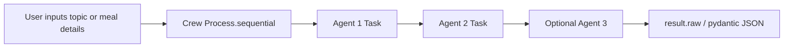

# Module 7: Agentic AI with CrewAI

## Module Overview

**CrewAI** examples connect to **Ollama** via `LLM(model="ollama/llama3.1:8b", base_url="http://localhost:11434")`. You define **agents** (role, goal, backstory), **tasks** (description, expected output, optional `context`), and run a **Crew** with sequential `Process`.

Prerequisites: [Module 1](../FoundationsOfGenAIAndPromptEng/README.md) and familiarity with agents from [Module 5](../FoundationsOfAIAgents/README.md).

---

## Learning Objectives

- Configure CrewAI to use a local Ollama model.
- Chain tasks so later tasks receive earlier outputs via `context=[...]`.
- Attach a custom `@tool` to an agent with iteration limits.
- Emit **structured outputs** with Pydantic models (`output_pydantic`).

---

## Concepts Covered

### Multi-agent sequential crew

**`BasicsOfCrewAI.py`**: Researcher → Technical Writer → Social Media Strategist on a user-supplied `{topic}`. Prints final raw output and per-task outputs.

### Single agent + tool

**`TasksAndAgents.py`**: `simple_search` tool returns canned Tesla facts; agent must research `{topic}` with `max_iter=3`.

### Structured grocery planning

**`GroceryPlanner.py`**: Meal Planner agent → Shopping Organizer agent; tasks use `MealPlan` and `GroceryShoppingPlan` Pydantic schemas; interactive CLI collects meal name, servings, budget, dietary restrictions, skill level.

---

## Architecture and Workflow



---

## Project Structure

```text
AgenticAIWithCrewAI/
├── BasicsOfCrewAI.py    # 3-agent content pipeline
├── TasksAndAgents.py    # Tool + single agent
└── GroceryPlanner.py    # 2-agent meal + shopping plan with Pydantic
```

---

## Prerequisites

- Ollama running with `llama3.1:8b`.
- CrewAI and pydantic: `pip install crewai pydantic` (verify version compatibility with your Python).

---

## Installation and Setup

```bash
cd AgenticAIWithCrewAI
pip install crewai pydantic
ollama pull llama3.1:8b
```

CrewAI may pull additional dependencies on install, allow time for resolution.

---

## How to Run

All scripts use `if __name__ == "__main__"` and prompt on stdin:

```bash
python BasicsOfCrewAI.py
python TasksAndAgents.py
python GroceryPlanner.py
```

**BasicsOfCrewAI**: verbose logging shows agent reasoning; final sections print research, article, and social posts.

**GroceryPlanner**: if `result.pydantic` is populated, prints `model_dump_json` for the shopping plan.

---

## Code Walkthrough

- **`LLM` wrapper**: `model="ollama/llama3.1:8b"` tells CrewAI to use Ollama’s OpenAI-compatible endpoint.
- **Task `context`**: wires DAG-style dependencies without manual passing of strings.
- **`output_pydantic`**: encourages schema-constrained final objects, compare to freeform `result.raw`.

---

## Key Takeaways

- CrewAI optimizes for role-based multi-agent workflows with minimal graph code.
- Sequential process is easiest to debug; parallel/delegation patterns exist in CrewAI but are not shown here (`allow_delegation=False` everywhere).
- Local LLMs may struggle with strict JSON/Pydantic, retry or simplify tasks if validation fails.

---

## Common Issues and Troubleshooting

- **Connection to Ollama**: Confirm `http://localhost:11434` matches your Ollama host.
- **Structured output empty**: Model may not satisfy schema; check verbose logs and reduce field complexity.
- **Long runtimes**: Multi-agent crews call the LLM many times, start with short topics.

---

## Next Steps

- [Model Context Protocol](../ModelContextProtocol/README.md)
- Compare with [LangGraph meal orchestrator](../AgenticAIWithLangGraph/DesignPatterns/01_orchestrator_worker_meal_planner.py)
