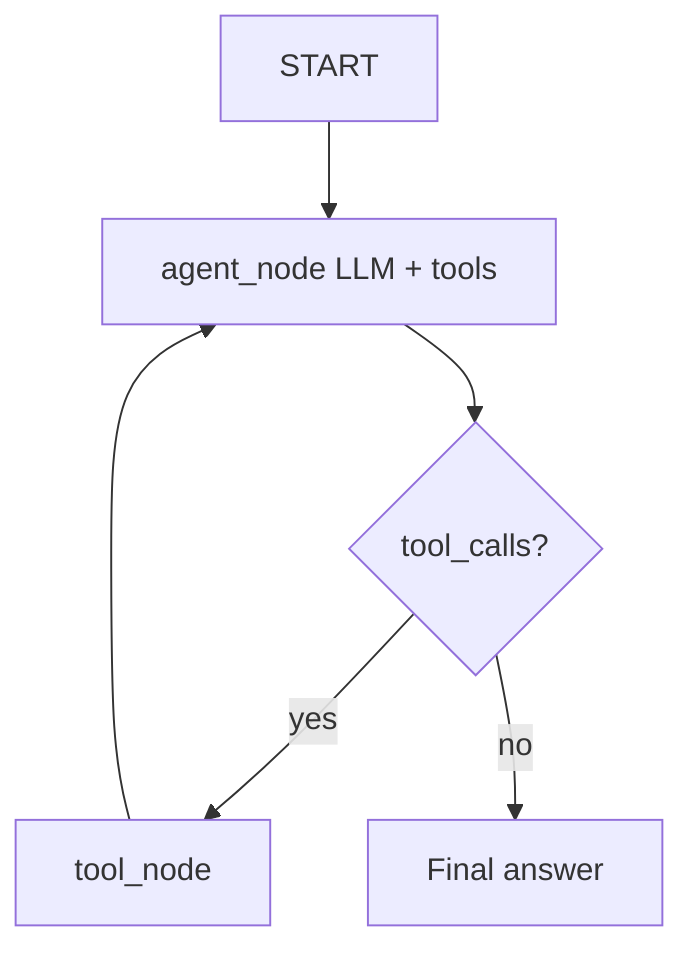

# Module 6: Agentic AI with LangGraph

## Module Overview

LangGraph **`StateGraph`** examples teach **state**, **nodes**, **edges**, and **conditional routing**, plus agent patterns (**ReAct**, **reflection**, **reflexion**). Subfolders add **workflow patterns** (chaining, routing, parallelization, multi-agent routing) and **design patterns** (orchestrator–worker meal planner, reflection investment advisor).

Prerequisites: [Module 5](../FoundationsOfAIAgents/README.md) and Module 1 chains.

---

## Learning Objectives

- Define typed state with `TypedDict` and compile a graph with `END`.
- Route requests with conditional edges and LLM classifiers.
- Implement ReAct-style **agent ↔ tools** loops with message state.
- Build **reflection** loops (generate → critique → improve).
- Explore **Send**-based orchestrator–worker parallelism.

---

## Concepts Covered

### LangGraph basics

**`LangGraph_Basics.py`**: validate → inject static LangGraph context if question mentions “langgraph” → answer or reject. Streamlit UI.

### ReAct agent graph

**`ReActAgent.py`**: `agent_node` calls `llm.bind_tools`; `tool_node` executes calculator/weather tools; `should_continue` routes to tools or `END`. Weather data is **mocked** in code.

### Reflection

**`ReflectionAgent.py`**: alternating `generate_node` and `reflect_node` for LinkedIn posts, max 3 iterations.

### Reflexion

**`ReflexionAgent.py`**: responder parses ANSWER/CRITIQUE/NEEDS_RESEARCH; `retrieve_knowledge` injects a static knowledge string; `revisor` improves answer until satisfactory or max iterations.

### WorkflowPatterns/

| File | Pattern |
|------|---------|
| `1_PromptChaining.py` | Job description → resume summary → cover letter |
| `2_Routing.py` | Classify summarize vs translate (French) |
| `3_Parallelization.py` | Parallel translation to French, Spanish, Japanese |
| `4_MultiAgentRouting.py` | Route to ride / restaurant / groceries handlers |

### DesignPatterns/

| File | Pattern |
|------|---------|
| `01_orchestrator_worker_meal_planner.py` | Orchestrator splits meals; `Send` dispatches worker nodes; Pydantic `Dish` schema |
| `02_reflection_investment_advisor.py` | Investment plan with graded risk reflection loop |

---

## Architecture and Workflow (ReAct)



---

## Project Structure

```text
AgenticAIWithLangGraph/
├── LangGraph_Basics.py
├── ReActAgent.py
├── ReflectionAgent.py
├── ReflexionAgent.py
├── WorkflowPatterns/
│   ├── 1_PromptChaining.py
│   ├── 2_Routing.py
│   ├── 3_Parallelization.py
│   └── 4_MultiAgentRouting.py
└── DesignPatterns/
    ├── 01_orchestrator_worker_meal_planner.py
    └── 02_reflection_investment_advisor.py
```

---

## Prerequisites

- Ollama `llama3.1:8b` (several files set `base_url="http://127.0.0.1:11434"`).
- Packages: `langgraph`, `langchain-ollama`, `langchain-core`, `streamlit`, `pydantic`.

---

## Installation and Setup

```bash
cd AgenticAIWithLangGraph
pip install langgraph langchain-ollama langchain-core streamlit pydantic
ollama pull llama3.1:8b
```

---

## How to Run

Each top-level and pattern file is a **Streamlit app** unless noted:

```bash
streamlit run LangGraph_Basics.py
streamlit run ReActAgent.py
streamlit run ReflectionAgent.py
streamlit run ReflexionAgent.py
streamlit run WorkflowPatterns/1_PromptChaining.py
# ... likewise for other WorkflowPatterns and DesignPatterns scripts
```

**ReflexionAgent** sets `OLLAMA_LLM_LIBRARY=cpu` in code.

---

## Code Walkthrough

- **`add_messages` reducer** in ReAct: append-only message list is the standard LangGraph agent state.
- **`eval` in calculator tool**: restricted builtins, still a teaching hazard; do not deploy as-is.
- **Orchestrator worker**: uses LangGraph `Send` to fan out meal sections, study for map-reduce style agent design.

---

## Key Takeaways

- Graphs make control flow explicit compared to hidden agent loops.
- Conditional edges encode routers and termination.
- Reflection/reflexion trade latency for output quality.

---

## Common Issues and Troubleshooting

- **Tool call loops**: Local models sometimes omit tools; rephrase or increase context.
- **Parallelization graph**: Requires LangGraph version supporting `START` API used in `3_Parallelization.py`, upgrade `langgraph` if imports fail.

---

## Next Steps

- [Model Context Protocol](../ModelContextProtocol/README.md) ,  `MCP_Application.py` uses `create_react_agent`
- [Agentic AI with CrewAI](../AgenticAIWithCrewAI/README.md)
