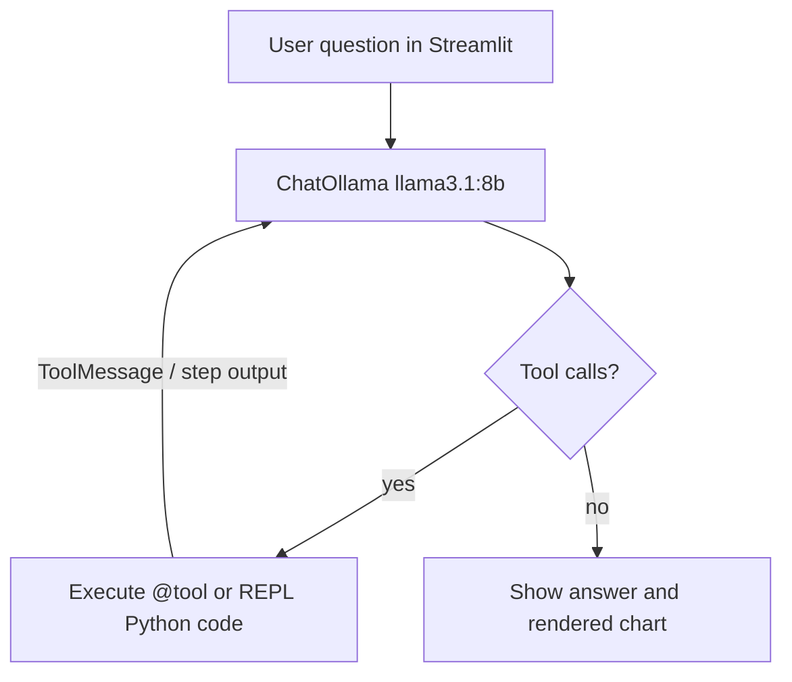

# Module 5: Foundations of AI Agents

## Module Overview

Three **Streamlit** applications demonstrate agent patterns: a **math tool agent** (`create_agent`), a **custom tool-loop** data analyst over CSV files, and a **pandas DataFrame agent** that can generate matplotlib/seaborn charts. All use **local Ollama** (`llama3.1:8b`).

Prerequisites: [Module 1](../FoundationsOfGenAIAndPromptEng/README.md) tools and agents (`7_Agent.py`).

---

## Learning Objectives

- Expose Python functions as LangChain tools and let the model choose them.
- Implement a manual **tool-call loop** with `ToolMessage` feedback and exception safety.
- Use `create_pandas_dataframe_agent` for natural-language data exploration and chart generation.
- Understand how bundled datasets (`classification-dataset.csv` and `regression-dataset.csv`) integrate with ML and visualization agents.

---

## Concepts Covered

### Tool-calling agent (high-level API)

**`ToolCalling.py`**: Uses `create_agent(model=llm, tools=..., system_prompt=...)` from `langchain.agents` with arithmetic tools (`add_numbers`, `subtract_numbers`, `multiply_numbers`, `divide_numbers`). Streamlit UI accepts mathematical queries and displays the agent's step-by-step reasoning and answer.

### Explicit tool loop

**`DataAnalysisAgent.py`**: Binds tools with `llm.bind_tools(tools)` and executes an explicit control loop (up to 5 iterations). If `response.tool_calls` is returned, each tool is executed and appended as a `ToolMessage` before recurring back to the model. Tools include:
- `list_csv_files`: Finds all `.csv` files in the script directory or workspace.
- `preload_datasets`: Loads and caches DataFrames in memory.
- `get_dataset_summary`: Returns column names, data types, and row/column counts.
- `dataframe_analysis`: Executes `head`, `tail`, `describe`, or `info`.
- `classification`: One-hot encodes features and trains a `RandomForestClassifier` (default target: `target` on `classification-dataset.csv`).
- `regression`: One-hot encodes features and trains a `RandomForestRegressor` (default target: `price` on `regression-dataset.csv`).

### Code-executing dataframe agent

**`VisualizationAgent.py`**: Uses `create_pandas_dataframe_agent` with `allow_dangerous_code=True` to execute Python, pandas, and matplotlib/seaborn code on demand. Features dual-mode data loading: users can pick from bundled datasets (`classification-dataset.csv` or `regression-dataset.csv`) or upload any custom CSV file. Uses `matplotlib.use("Agg")` to prevent GUI thread blocking and renders plots with `st.pyplot(fig)`.

---

## Architecture and Workflow



---

## Project Structure

```text
FoundationsOfAIAgents/
├── ToolCalling.py              # Math agent UI using create_agent
├── DataAnalysisAgent.py        # Explicit tool-calling loop + scikit-learn ML tools
├── VisualizationAgent.py       # Natural-language dataframe analysis + chart generator
├── classification-dataset.csv  # 500-row dataset for classification (target: 'target')
├── regression-dataset.csv      # 500-row housing dataset for regression (target: 'price')
└── README.md                   # Module documentation
```

---

## Dataset Details

Both bundled datasets are pre-cleaned and ready for analysis:

| Dataset | Rows × Cols | Features | Target Column | Task |
|---------|-------------|----------|---------------|------|
| `classification-dataset.csv` | 500 × 6 | `age`, `income`, `experience_years`, `education`, `credit_score` | `target` (0 or 1, balanced 250/250) | Binary classification via `RandomForestClassifier` |
| `regression-dataset.csv` | 500 × 6 | `size_sqft`, `bedrooms`, `bathrooms`, `age_years`, `location` | `price` | House price regression via `RandomForestRegressor` |

Both datasets include categorical text features (`education` and `location`) which are automatically converted via `pd.get_dummies(..., drop_first=True)`.

---

## Prerequisites

- Ollama with `llama3.1:8b` pulled.
- Packages: `streamlit`, `langchain`, `langchain-ollama`, `langchain-core`, `langchain-experimental`, `pandas`, `scikit-learn`, `matplotlib`, `seaborn`.

---

## Installation and Setup

```bash
cd FoundationsOfAIAgents
pip install streamlit langchain langchain-ollama langchain-core langchain-experimental pandas scikit-learn matplotlib seaborn
ollama pull llama3.1:8b
```

---

## How to Run

You can launch each Streamlit app directly from `FoundationsOfAIAgents` or from the repository root:

```bash
# 1. Math Assistant
streamlit run FoundationsOfAIAgents/ToolCalling.py

# 2. Data Analysis Wizard
streamlit run FoundationsOfAIAgents/DataAnalysisAgent.py

# 3. Data Visualization Agent
streamlit run FoundationsOfAIAgents/VisualizationAgent.py
```

### Example Queries to Try

- **ToolCalling.py**:
  - *"What is 25 multiplied by 4?"*
  - *"Divide 100 by 5 and add 12"*
- **DataAnalysisAgent.py**:
  - *"What datasets are available in the folder?"*
  - *"Give me a summary of classification-dataset.csv"*
  - *"Run classification on classification-dataset.csv with target column target"*
  - *"Train a regression model on regression-dataset.csv"*
- **VisualizationAgent.py**:
  - Select `classification-dataset.csv` → *"Plot a bar chart of education distribution"*
  - Select `regression-dataset.csv` → *"Show a scatter plot of size_sqft versus price"*

---

## Code Walkthrough

- **`ToolCalling.py`**: Modern LangChain `create_agent` API creates a compiled state graph with bound tools and system prompt.
- **`DataAnalysisAgent.py`**: Employs path resolution (`_resolve_file_path`) so datasets load properly regardless of working directory; tool execution handles errors gracefully without breaking the chat session.
- **`VisualizationAgent.py`**: Configured with `matplotlib.use("Agg")` and `plt.close("all")` for clean multi-turn plotting; inspects `intermediate_steps` to display generated Python code inside an expander.
- **Windows CPU Safeguard**: All three scripts set `os.environ.setdefault("OLLAMA_LLM_LIBRARY", "cpu")` to prevent Ollama driver initialization crashes on Windows systems lacking CUDA setup.

---

## Key Takeaways

- Agents combine LLM reasoning with external tool execution and a control loop (framework-managed via `create_agent` or custom-rolled).
- `allow_dangerous_code=True` enables code execution for local data analysis; keep it restricted to trusted, local environments.
- Path resolution and robust error handling in tools ensure agents recover gracefully when user inputs or file names vary.

---

## Common Issues and Troubleshooting

- **Ollama Connection**: Ensure Ollama is running (`ollama serve`) and `llama3.1:8b` is pulled (`ollama pull llama3.1:8b`).
- **CUDA Overrun Error on Windows**: Handled automatically via `OLLAMA_LLM_LIBRARY=cpu`. If running manually, launch `ollama serve` with CPU inference.
- **Slow Generation on CPU**: Local models running on CPU take a little longer to execute multi-step tool calls; allow 15–30 seconds per complex query.

---

## Next Steps

- [Agentic AI with LangGraph](../AgenticAIWithLangGraph/README.md) — graph-based multi-agent workflows.
- [Agentic AI with CrewAI](../AgenticAIWithCrewAI/README.md) — role-playing cooperative multi-agent teams.
