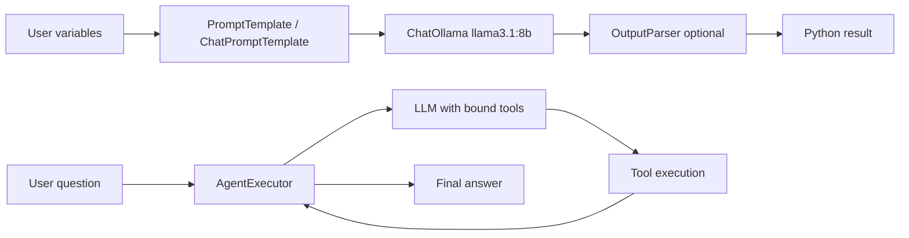

# Module 1: Foundations of Generative AI and Prompt Engineering

## Module Overview

This module introduces the core **LangChain** building blocks used throughout the repository: **prompt templates**, **LangChain Expression Language (LCEL)**, **LLM chaining**, **output parsers**, **custom tools**, **tool binding**, and a **tool-calling agent**. Files 1, 2, and 5 run standalone without an LLM; files 3, 4, 6, and 7 use **Ollama** with `llama3.1:8b`.

Place in the roadmap: complete this module in sequence (1 → 7) before moving on to vector databases, RAG pipelines, and multi-agent frameworks.

---

## Concepts Covered

### 1. Prompt Templates
**What:** Structured prompt blueprints with runtime placeholders (such as `{topic}` or `{history}`).  
**Why:** Separate prompt instructions from runtime user data, reuse prompts cleanly, and structure chat roles or few-shot examples.  
**How here:** `1_promptTemplate.py` demonstrates `PromptTemplate`, `.partial()`, `ChatPromptTemplate`, `MessagesPlaceholder`, and `FewShotPromptTemplate`.

### 2. LangChain Expression Language (LCEL)
**What:** A declarative way to compose `Runnable` components sequentially (`|` / `RunnableSequence`), in parallel (`RunnableParallel`), or with pass-through enrichment (`RunnablePassthrough`).  
**Why:** Produces readable, composable pipelines (`prompt | llm | parser`) with unified `.invoke()`, `.batch()`, and `.stream()` interfaces.  
**How here:** `2_langchainExpressionLanguage.py` demonstrates LCEL primitives with pure Python `RunnableLambda` functions before `3_langchainChaining.ipynb` and `4_outputParser.py` apply them to a real LLM.

### 3. Output Parsers
**What:** Runnables that convert raw `AIMessage` responses into structured Python types (strings, dictionaries, lists).  
**Why:** Downstream application code needs predictable data types instead of unstructured text.  
**How here:** `4_outputParser.py` chains `ChatOllama` with `StrOutputParser`, `JsonOutputParser`, and `CommaSeparatedListOutputParser`.

### 4. Tools and Tool Binding
**What:** Typed, documented Python functions registered via `@tool` and exposed to an LLM via `llm.bind_tools(...)`.  
**Why:** Gives models deterministic capabilities (math, APIs, search) and lays the groundwork for agents and MCP.  
**How here:** `5_toolsLangchain.py` defines and invokes math tools directly; `6_toolsBinding.py` binds a tool to `ChatOllama` and inspects `response.tool_calls`.

### 5. Agents
**What:** An execution loop where the LLM decides which tool to call, observes the tool's output, and produces a final answer.  
**Why:** Automates multi-step reasoning and tool execution instead of manually dispatching `tool_calls`.  
**How here:** `7_Agent.py` combines `create_tool_calling_agent` and `AgentExecutor` with `add` and `sub` tools.

---

## Architecture and Workflow




---

## Sequential Walkthrough of the 7 Files

Follow these seven files in order, each file builds directly on the concepts introduced in the previous ones.

### 1. `1_promptTemplate.py` ,  Prompt Templates
- **Goal:** Understand how to parameterize and structure prompts before introducing any LLM calls.
- **What it covers:**
  1. **Basic `PromptTemplate.from_template()`**: Formats placeholders with `.format()` (returns a plain string) and `.invoke()` (returns a LangChain `StringPromptValue`).
  2. **Partial templates (`.partial()`)**: Pre-fills fixed variables (`audience`, `language`) while leaving dynamic variables (`topic`) for runtime.
  3. **`ChatPromptTemplate.from_messages()`**: Builds role-tagged `system` and `human` messages expected by chat models.
  4. **`MessagesPlaceholder`**: Injects a variable-length list of `HumanMessage` / `AIMessage` objects (such as conversation history, the same mechanism used for `agent_scratchpad` in File 7).
  5. **`FewShotPromptTemplate`**: Supplies concrete input/output examples to steer model behavior.
- **LLM required:** No.

### 2. `2_langchainExpressionLanguage.py` ,  LangChain Expression Language (LCEL)
- **Goal:** Learn how LangChain connects components through the unified `Runnable` interface.
- **What it covers:**
  1. **`RunnableLambda`**: Wraps ordinary Python functions so they support `.invoke()`, `.batch()`, and piping.
  2. **`RunnableSequence` vs. Pipe (`|`)**: Demonstrates that `RunnableSequence(a, b, c)` and `a | b | c` build the exact same left-to-right data pipeline.
  3. **`RunnableParallel`**: Fans a single input out to multiple branches (`word_count`, `char_count`, `uppercase`) and returns a combined dictionary.
  4. **`RunnablePassthrough.assign()`**: Preserves all existing dictionary keys while computing and attaching new derived fields (a core pattern later used in RAG pipelines).
  5. **Composing `PromptTemplate` with LCEL (`.invoke()` & `.batch()`)**: Previews the `prompt | llm` pipeline with a lightweight mock model function and runs multiple inputs in one call via `.batch()`.
- **LLM required:** No.

### 3. `3_langchainChaining.ipynb` ,  LLM Invocation & Multi-Step Chaining
- **Goal:** Connect your prompt templates and LCEL chains to a real local LLM (`ChatOllama(model="llama3.1:8b")`).
- **What it covers:**
  1. **Direct invocation**: Calls `llm.invoke("Explain machine learning in one sentence.")` and prints `response.content`.
  2. **Manual prompt formatting**: Invokes a `PromptTemplate` first and passes the result into `llm.invoke(...)`.
  3. **LCEL chaining (`prompt | llm`)**: Combines the prompt template and LLM into a single runnable chain.
  4. **`AIMessage` anatomy**: Includes a reference table documenting key response attributes (`content`, `additional_kwargs`, `response_metadata`, `id`, `tool_calls`, `invalid_tool_calls`, `usage_metadata`).
  5. **Multi-step LLM chaining**: Feeds the output of one chain into the next (`meal_chain` → `recipe_chain` → `time_chain`) to pick a classic dish, generate a recipe, and estimate cooking time.
- **LLM required:** Yes (`ollama` with `llama3.1:8b`).

### 4. `4_outputParser.py` ,  Output Parsers
- **Goal:** Extend `prompt | llm` to `prompt | llm | parser` so raw LLM text becomes structured Python data.
- **What it covers:**
  1. **`StrOutputParser()`**: Extracts the plain text string directly from the `AIMessage` (`chain1`).
  2. **`JsonOutputParser()`**: Parses JSON-formatted LLM output into a Python dictionary (`chain2`). Notes an important caveat: it verifies valid JSON syntax and deserialization, not whether specific schema keys are present.
  3. **`CommaSeparatedListOutputParser()`**: Splits comma-separated model output into a Python list (`chain3`).
- **LLM required:** Yes (`ollama` with `llama3.1:8b`).

### 5. `5_toolsLangchain.py` ,  Defining Custom Tools
- **Goal:** Learn how to turn standard Python functions into LangChain tools with schemas derived from type hints and docstrings.
- **What it covers:**
  - Uses the `@tool` decorator from `langchain_core.tools` to define three math tools: `sqaure`, `factorial`, and `multiply`.
  - Demonstrates invoking each tool directly via `.invoke({...})` with an argument dictionary (`{'a': 4}`, `{'a': 4, 'b': 10}`).
- **LLM required:** No.

### 6. `6_toolsBinding.py` ,  Tool Binding with an LLM
- **Goal:** Teach the LLM what tools exist so it can decide *when* to request a tool call and *with what arguments*.
- **What it covers:**
  - Defines an `add` tool with `@tool` and registers it on `ChatOllama(model="llama3.1:8b")` using `llm.bind_tools([add])`.
  - Sends `"What is 4+8?"` to `llm_tools.invoke(...)` and prints both the full `AIMessage` and `response.tool_calls`.
  - Highlights a key distinction: **tool binding** only lets the model emit structured tool-call requests, it does not execute the Python function automatically.
- **LLM required:** Yes (`ollama` with `llama3.1:8b`).

### 7. `7_Agent.py` ,  Building a Tool-Calling Agent
- **Goal:** Close the loop so an agent can automatically invoke tools, read their outputs, and return a final natural-language answer.
- **What it covers:**
  - Defines `add` and `sub` tools and builds a `ChatPromptTemplate` containing `system`, `human`, and `("placeholder", "{agent_scratchpad}")` messages (where intermediate tool calls and observations are stored).
  - Wires the LLM, tools, and prompt together using `create_tool_calling_agent(...)` and runs them inside `AgentExecutor(..., verbose=True)`.
  - Invokes the agent with `{"input": "What is 25 added to 12?"}`, displaying the step-by-step reasoning/tool execution trace and printing `response["output"]`.
- **LLM required:** Yes (`ollama` with `llama3.1:8b`).

---

## Prerequisites

- Python 3.10+ (tested on Python 3.11).
- [Ollama](https://ollama.com/) installed and running locally with `llama3.1:8b` pulled (required for Files 3, 4, 6, and 7).
- Packages: `langchain-core`, `langchain-ollama`, `langchain` (for agent APIs in `7_Agent.py`), and `jupyter` / `ipywidgets` for the notebook.

---

## Installation and Setup

```bash
cd FoundationsOfGenAIAndPromptEng
python -m venv .venv
# activate your virtual environment, then:
pip install langchain-core langchain-ollama langchain jupyter ipywidgets
ollama pull llama3.1:8b
```

---

## How to Run (In Sequence)

| Step | File | Command | Needs Ollama? | What You'll See |
|------|------|---------|---------------|-----------------|
| 1 | `1_promptTemplate.py` | `python 1_promptTemplate.py` | No | Formatted outputs for basic, partial, chat, placeholder, and few-shot templates. |
| 2 | `2_langchainExpressionLanguage.py` | `python 2_langchainExpressionLanguage.py` | No | LCEL runnable execution: sequence vs `\|`, parallel dict, passthrough `.assign()`, and `.batch()`. |
| 3 | `3_langchainChaining.ipynb` | `jupyter notebook 3_langchainChaining.ipynb` | Yes | Interactive cells: `llm.invoke()`, `prompt \| llm`, `AIMessage` reference, and multi-step recipe chain. |
| 4 | `4_outputParser.py` | `python 4_outputParser.py` | Yes | Three LLM calls parsed into a string, a JSON dict, and a Python list. |
| 5 | `5_toolsLangchain.py` | `python 5_toolsLangchain.py` | No | Direct `.invoke()` results for `factorial`, `sqaure`, and `multiply` tools. |
| 6 | `6_toolsBinding.py` | `python 6_toolsBinding.py` | Yes | Raw `AIMessage` and structured `response.tool_calls` requesting `add(a=4, b=8)`. |
| 7 | `7_Agent.py` | `python 7_Agent.py` | Yes | Verbose agent execution trace calling `add` and printing the final answer. |

---

## Key Takeaways

- **Prompt templates** decouple instructions from runtime variables and support chat roles, conversation history, and few-shot prompting.
- **LCEL (`|`, `RunnableParallel`, `RunnablePassthrough`)** builds clean, composable pipelines without custom glue code.
- **Output parsers** turn model text into Python data structures, always validate required fields when using `JsonOutputParser` (or use Pydantic/structured output for strict schemas).
- **Tools → Tool Binding → Agents** form a direct progression: define functions (`@tool`), expose schemas to the model (`bind_tools`), then automate the decide-execute-observe loop (`AgentExecutor`).

---

## Common Issues and Troubleshooting

- **`Connection refused` to Ollama**: Ensure Ollama is running (`ollama serve`) and confirm `ollama list` includes `llama3.1:8b`.
- **Import errors for `langchain.agents`**: Install the `langchain` package and keep `langchain` / `langchain-core` / `langchain-ollama` versions aligned (agent APIs can change across major versions).
- **Notebook `tqdm` warning**: Optional, install `ipywidgets` if Jupyter warns about progress bars.

---

## Next Steps

- [Vector Databases for RAG](../VectorDatabasesForRAG/README.md) ,  embeddings, chunking, and similarity search.
- [Foundations of AI Agents](../FoundationsOfAIAgents/README.md) ,  deeper dive into agent architectures after completing `7_Agent.py`.
