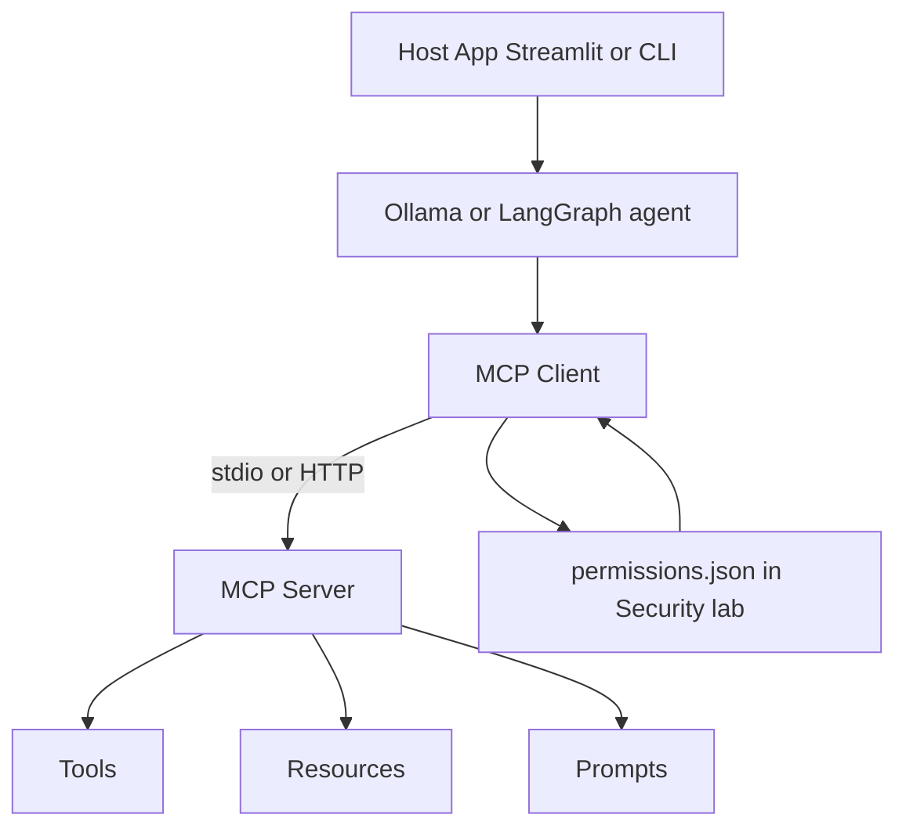

# Module 8: Model Context Protocol (MCP)

## Module Overview

The **Model Context Protocol** standardizes how AI applications discover and call **tools**, read **resources**, and use **prompts** exposed by servers. This module progresses from **FastMCP** file servers and clients to **HTTP transport**, a **multi-server LangGraph agent**, and a **security lab** with permission gates.

Prerequisites: async Python basics, [Module 6](../AgenticAIWithLangGraph/README.md) (`create_react_agent`), local Ollama.

---

## Learning Objectives

- Build an MCP server with **FastMCP** (tools, resources, prompts, progress reporting).
- Connect a **FastMCP Client** to a server script and drive menus with **Ollama**.
- Use **stdio** and **HTTP** transports (`streamable_http`).
- Combine **Context7** and **Met Museum** MCP servers in one LangGraph ReAct agent.
- Enforce **allow / ask / deny** policies before tool execution.

---

## Concepts Covered

### MCP primitives (ClientServerArchitecture)

**`ClientServerArchitecture/server.py`**: tools `write_file`, `delete_file`; resources `file:///{file_name}`, `dir:///`; prompts `code_review`, `documentation_generator` (with `ctx.elicit` for user input). Paths constrained to project directory via `get_path`.

**`ClientServerArchitecture/client.py`**: connects with `Client(server_script_path, mode="legacy")`; menu for documentation, code review, read file/dir, or chat.

### Consumer client (Context7)

**`MCP_Client.py`**: `fastmcp` `StdioTransport` (`npx @upstash/context7-mcp`) or `StreamableHttpTransport` to `https://mcp.context7.com/mcp`; lists tools, resolves library id, queries docs.

### Multi-server agent application

**`MCP_Application.py`**: `MultiServerMCPClient` with Context7 (HTTP) and `metmuseum-mcp` (stdio via npx); tools loaded into LangGraph `create_react_agent` with `InMemorySaver` checkpointer; CLI Q&A loop.

### HTTP file server lab

**`MCP_HTTPS/server.py`**: FastMCP HTTP on `127.0.0.1:8000`, workspace `MCP_HTTPS/workspace/` with path sandbox checks.

**`MCP_HTTPS/client.py`**, **`app.py`**, **`host_app.py`**: Streamlit/async clients calling MCP over HTTP; **`host_app.py`** uses Ollama tool-calling against MCP tools (large file, primary integrated demo).

### Security lab

**`MCP_Security/server.py`**: tools `read_file`, `write_file`, `delete_file`, `execute_command` (simulated only) scoped to `data/`.

**`MCP_Security/client.py`**: `MCPPermissionClient` reads **`permissions.json`** (`allow`, `ask`, `deny` per tool), audit logging.

**`MCP_Security/ai_host.py`**, **`app.py`**: Streamlit hosts that connect LLM tool calls to permission-aware client.

---

## Architecture and Workflow



---

## Project Structure

```text
ModelContextProtocol/
├── MCP_Client.py                 # Context7 stdio/HTTP demo
├── MCP_Application.py            # Multi-server LangGraph + Ollama
├── ClientServerArchitecture/
│   ├── server.py                 # FastMCP file ops + prompts
│   └── client.py                 # Menu-driven FastMCP client
├── MCP_HTTPS/
│   ├── server.py                 # HTTP FastMCP on port 8000
│   ├── client.py
│   ├── app.py
│   ├── host_app.py               # Streamlit + Ollama + MCP HTTP
│   └── workspace/                # Sandboxed files for HTTP tools
└── MCP_Security/
    ├── server.py
    ├── client.py
    ├── ai_host.py
    ├── app.py
    ├── permissions.json
    ├── test_client.py
    └── data/                     # Sandboxed data files
```

---

## Prerequisites

- **Python packages** (varies by subfolder): `fastmcp`, `mcp`, `langchain-ollama`, `langchain-mcp-adapters`, `langgraph`, `streamlit`, `ollama`, `pydantic`.
- **Node.js / npx** for `@upstash/context7-mcp` and `metmuseum-mcp`.
- **Ollama** `llama3.1:8b` for host apps and `MCP_Application.py`.
- Network for Context7 HTTP endpoint (verify availability).

---

## Installation and Setup

Install packages for the sub-lab you run (there is no unified requirements file):

```bash
cd ModelContextProtocol
pip install fastmcp mcp langchain-ollama langchain-mcp-adapters langgraph streamlit ollama pydantic
```

---

## How to Run

### Client / server architecture

**Terminal 1** (from `ClientServerArchitecture`, server uses cwd as base):

```bash
cd ModelContextProtocol/ClientServerArchitecture
python server.py
```

**Terminal 2**:

```bash
python client.py server.py
```

Use menu options 1–5; documentation prompt may elicit file path and doc name via stdin.

### Context7 lab

```bash
cd ModelContextProtocol
python MCP_Client.py
```

Choose `1` (stdio, requires npx) or `2` (HTTP).

### Multi-server MCP agent

```bash
cd ModelContextProtocol
python MCP_Application.py
```

Wait for tool listing; follow menu (`1` ask, `2` quit). First invocation includes a scripted introduction message.

### HTTP workspace server

**Terminal 1**:

```bash
cd ModelContextProtocol/MCP_HTTPS
python server.py
```

**Terminal 2** (examples):

```bash
streamlit run host_app.py
# or
streamlit run app.py
# or
python client.py
```

Default server URL in host apps: `http://127.0.0.1:8000/mcp`.

### Security lab

**Terminal 1**:

```bash
cd ModelContextProtocol/MCP_Security
python server.py
```

**Terminal 2**:

```bash
streamlit run ai_host.py
# or test_client.py / app.py with server running via stdio
```

Edit **`permissions.json`** to change default policy (for example `write_file`: `ask`).

---

## Code Walkthrough

- **`get_path` / `get_safe_path`**: path canonicalization prevents directory traversal, compare HTTP workspace checks vs security `data/` jail.
- **`MCP_Application.py`**: demonstrates aggregating tools from multiple servers into one agent graph.
- **`execute_command`**: returns simulated output only, documented in server docstring.

---

## Key Takeaways

- MCP separates **capability providers** (servers) from **orchestrators** (hosts/agents).
- Transports (stdio vs HTTP) suit local dev vs remote services.
- Human-in-the-loop permissions are essential for risky tools.

---

## Common Issues and Troubleshooting

- **npx first run slow**: Packages download on demand; ensure Node is installed.
- **HTTP connection refused**: Start `MCP_HTTPS/server.py` before Streamlit host.
- **`MCP_Security/server.py` import `MCPServer`**: Requires compatible `mcp` package providing that API, if import fails, verify MCP SDK version against your environment.
- **Context7 / Met Museum availability**: External services may change; treat as optional demos.

---

## Next Steps

- Revisit [LangGraph ReAct](../AgenticAIWithLangGraph/ReActAgent.py) and compare tool routing with MCP-backed tools.
- Harden paths and permissions before any real deployment.

---

## Related Learning Modules

- [Agentic AI with LangGraph](../AgenticAIWithLangGraph/README.md)
- [Foundations of AI Agents](../FoundationsOfAIAgents/README.md)
