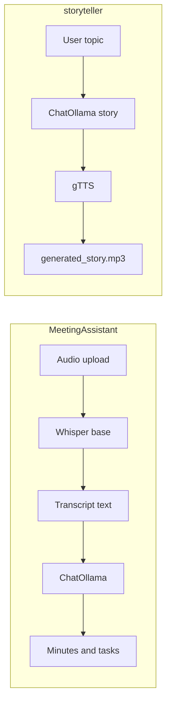

# Module 4: Multimodal Generative AI

## Module Overview

Examples cover **speech-to-text** (OpenAI Whisper), **LLM summarization** of transcripts, **text generation + TTS** (gTTS), and a helper script to synthesize sample meeting audio. Together they show how non-text modalities connect to the same Ollama text models used elsewhere.

Prerequisite: [Module 1](../FoundationsOfGenAIAndPromptEng/README.md) for LLM prompts.

---

## Learning Objectives

- Transcribe audio with **Whisper** locally.
- Produce structured meeting minutes from a transcript with **ChatOllama**.
- Generate educational stories and convert them to MP3 with **gTTS**.
- Create synthetic meeting audio for testing the meeting assistant.

---

## Concepts Covered

### Speech-to-text (STT)

**`MeetingAssistant.py`**: loads Whisper `base` model, transcribes uploaded audio, then prompts Llama for minutes and action items with strict “do not invent” instructions.

### Text-to-speech (TTS)

**`storyteller.py`** and **`generatingMeetingAudio.py`**: use **gTTS** (Google’s online TTS API), requires internet; saves MP3 files locally.

### Multimodal pipeline pattern

Audio → transcript (Whisper) → text reasoning (LLM) → optional TTS output, mirrors image → vision model flows in [AI Nutrition Coach](../AI_NUTRITION_Coach/README.md).

---

## Architecture and Workflow



---

## Project Structure

```text
MultiModalGenAI/
├── SpeechToText/
│   ├── MeetingAssistant.py        # Streamlit: upload audio → transcript + minutes
│   └── generatingMeetingAudio.py  # CLI: sample meeting → generated_transcript.mp3
└── TextToSpeech/
    └── storyteller.py             # CLI: topic → story + MP3
```

---

## Prerequisites

- Ollama with `llama3.1:8b`.
- Whisper: `pip install openai-whisper` (downloads model weights on first run).
- gTTS: `pip install gtts` and network access for Google TTS.
- Streamlit for the meeting assistant.

---

## Installation and Setup

```bash
cd MultiModalGenAI
pip install streamlit openai-whisper langchain-ollama gtts
ollama pull llama3.1:8b
```

Whisper may require **ffmpeg** on your PATH, install if transcription fails (platform-specific).

---

## How to Run

**Meeting assistant (UI)**

```bash
cd SpeechToText
streamlit run MeetingAssistant.py
```

Upload mp3/wav/m4a/mp4, click **Generate Meeting Notes**. Writes temp file `meeting_audio` in the working directory.

**Generate sample audio**

```bash
cd SpeechToText
python generatingMeetingAudio.py
```

Creates `generated_transcript.mp3` from embedded sample dialogue.

**Storyteller**

```bash
cd TextToSpeech
python storyteller.py
```

Enter a topic at the prompt; prints story and saves `generated_story.mp3`.

---

## Code Walkthrough

- **`@st.cache_resource`** on Whisper + LLM avoids reloading models on each Streamlit rerun.
- **`fp16=False`** in transcribe: common CPU-friendly setting.
- **Meeting prompt**: numbered sections enforce structured output without a JSON parser.

---

## Key Takeaways

- Multimodal apps often chain specialized models (Whisper, vision) with a general LLM.
- Always separate **raw transcript** from **derived summaries** so users can audit hallucinations.
- gTTS is simple but not offline; plan accordingly for air-gapped environments.

---

## Common Issues and Troubleshooting

- **Whisper/ffmpeg errors**: Install ffmpeg; try a smaller audio file first.
- **gTTS failures**: Check network; Google may rate-limit anonymous TTS use.
- **Large audio on CPU**: Transcription can be slow, use shorter clips while learning.

---

## Next Steps

- [AI Nutrition Coach](../AI_NUTRITION_Coach/README.md) ,  vision + Ollama
- [Foundations of AI Agents](../FoundationsOfAIAgents/README.md)
