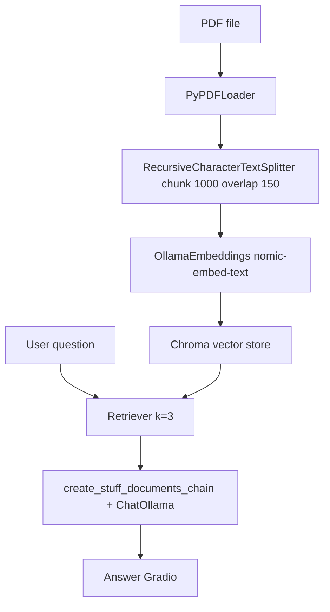

# PDF Q&A Bot

## Purpose

Two **Gradio** applications implement **retrieval-augmented generation** over PDF documents using **PyPDFLoader**, **RecursiveCharacterTextSplitter**, **Chroma**, **OllamaEmbeddings** (`nomic-embed-text`), and **ChatOllama** (`llama3.1:8b`) with LangChain **`create_retrieval_chain`**.

---

## Problem Statement

Answer questions about PDF content without sending the full document to the LLM on every query, retrieve relevant chunks first, then generate a grounded answer.

---

## Features (Implemented)

| Script | Behavior |
|--------|----------|
| `local_RAG_app.py` | Loads a **fixed PDF path** at startup, persists Chroma to `./chroma_db`, Gradio Q&A |
| `upload_PDF_RAG_app.py` | User uploads a PDF per question; builds an in-memory Chroma index each call |

Both refuse hallucination beyond context via prompt: *“I don't know based on the provided document.”*

---

## Technologies and Architecture



---

## Project Structure

```text
PDF_QA_Bot/
├── local_RAG_app.py       # Fixed PDF + persist_directory ./chroma_db
└── upload_PDF_RAG_app.py  # Upload PDF per session/query path
```

**Note:** `local_RAG_app.py` references `PDF_QA_Bot/document/sample.pdf`. That path is **not present** in the repository at documentation time, you must add your own PDF (see below).

---

## Prerequisites

- Ollama: `llama3.1:8b`, `nomic-embed-text`
- Packages: `gradio`, `langchain-community`, `langchain-chroma`, `langchain-ollama`, `langchain-text-splitters`, `langchain-core`, `langchain-classic`, PyPDF support (typically `pypdf`)

---

## Installation and Setup

```bash
pip install gradio langchain-community langchain-chroma langchain-ollama langchain-text-splitters langchain-core langchain-classic pypdf
ollama pull llama3.1:8b
ollama pull nomic-embed-text
```

### Local app PDF path

Create the directory and add a PDF:

```bash
mkdir PDF_QA_Bot\document
# copy your file to PDF_QA_Bot/document/sample.pdf
```

Or edit `loader = PyPDFLoader(...)` in `local_RAG_app.py` to point at your file.

---

## How to Run

### Fixed-document bot (with persistence)

Run from the **repository root** so paths resolve:

```bash
cd RAG_and_AgenticAI
python PDF_QA_Bot/local_RAG_app.py
```

- Creates or updates **`./chroma_db`** (gitignored at repo root).
- Launches Gradio **Local PDF QA Bot** in the browser.

Indexing runs **every time** the script starts (loads PDF, splits, embeds).

### Upload bot

```bash
python PDF_QA_Bot/upload_PDF_RAG_app.py
```

Upload a PDF and enter a question; index is rebuilt inside `ask_question` for each invocation.

---

## Code Walkthrough

- **`create_stuff_documents_chain`**: concatenates retrieved chunks into `{context}` for the prompt template.
- **`create_retrieval_chain`**: wires retriever + document chain; invoke with `{"input": question}`.
- **Persistence**: only `local_RAG_app.py` sets `persist_directory="./chroma_db"` relative to the **current working directory** (intended: repo root).

---

## Example Usage

After indexing a PDF about a known topic, ask factual questions answerable from the text. Questions outside the document should yield the configured “I don't know…” message.

---

## Troubleshooting and Limitations

- **FileNotFoundError for sample.pdf**: Add the file or change the loader path.
- **Wrong working directory**: Run `local_RAG_app.py` from repo root for `PDF_QA_Bot/document/...` and `chroma_db`.
- **Re-indexing cost**: Local app re-embeds on each launch, fine for learning, slow for large PDFs.
- **Upload app**: Rebuilds vector store per call, not optimized for production.

---

## Related Learning Modules

- [Advanced RAG Concepts](../AdvancedRAGConcepts/README.md)
- [Vector Databases for RAG](../VectorDatabasesForRAG/README.md)

---

## Possible Future Improvements (Not in Repo)

- Incremental indexing and cached vector store reuse.
- Source citations with page numbers from PyPDF metadata.
- Streamlit UI and multi-file libraries.
