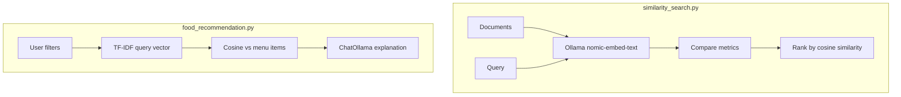

# Module 2: Vector Databases for RAG

## Module Overview

This module builds intuition for **semantic search** before full RAG stacks: you create **embeddings** with Ollama, compare vectors with **euclidean distance**, **dot product**, and **cosine similarity**, then see a **TF-IDF** recommendation system enhanced with an LLM explanation.

Prerequisite: [Module 1](../FoundationsOfGenAIAndPromptEng/README.md) (basic LangChain/Ollama familiarity).

---

## Learning Objectives

- Generate embeddings with the Ollama `nomic-embed-text` model.
- Rank documents by cosine similarity to a query embedding.
- Combine classical **TF-IDF** retrieval with an LLM narrative explanation.

---

## Concepts Covered

### Embeddings

**What:** Fixed-size numerical vectors representing text meaning.  
**Why:** Enable “similar meaning” search beyond keyword match.  
**How here:** `similiarity_search.py` calls `ollama.embeddings(model="nomic-embed-text", ...)`.

### Similarity metrics

| Metric | Role in `similiarity_search.py` |
|--------|-----------------------------------|
| Euclidean distance | Smaller = closer in space |
| Dot product | Related to alignment and magnitude |
| Cosine similarity | Scale-invariant; used for final ranking |

### TF-IDF vs dense embeddings

**`food_recommendation.py`** uses **TF-IDF + cosine similarity** on handcrafted food “feature” strings, not a vector DB, but the same *retrieve then explain* pattern as RAG. An LLM (`ChatOllama`) explains why top matches fit user preferences.

---

## Architecture and Workflow



---

## Project Structure

```text
VectorDatabasesForRAG/
├── similiarity_search.py    # Embeddings + metric comparison (note: filename spelling)
└── food_recommendation.py   # Interactive CLI: TF-IDF + Llama explanation
```

---

## Prerequisites

- Ollama with `nomic-embed-text` and `llama3.1:8b`.
- Python packages: `numpy`, `ollama`, `pandas`, `scikit-learn`, `langchain-ollama`.

---

## Installation and Setup

```bash
cd VectorDatabasesForRAG
pip install numpy ollama pandas scikit-learn langchain-ollama
ollama pull nomic-embed-text
ollama pull llama3.1:8b
```

---

## How to Run

**Similarity lab**

```bash
python similiarity_search.py
```

Expected: embedding shape printed, per-document metrics, then documents sorted by cosine similarity for query `"Who studies spiders?"`.

**Food recommender**

```bash
python food_recommendation.py
```

Follow prompts for cuisine, diet, spice, and food type; prints scored items and an LLM explanation.

---


## Key Takeaways

- Cosine similarity is the standard ranking metric for normalized embedding search.
- Not every “recommendation” system needs a vector DB; TF-IDF is a valid baseline.
- Module 3 replaces manual loops with **FAISS** and **Chroma**.

---

## Common Issues and Troubleshooting

- **Missing embedding model**: Run `ollama pull nomic-embed-text`.
- **Slow first run**: Ollama loads models on first request.

---

## Next Steps

- [Advanced RAG Concepts](../AdvancedRAGConcepts/README.md)
- Project: [YouTube RAG Bot](../YOUTUBE_RAG_Bot/README.md) (FAISS + embeddings)
