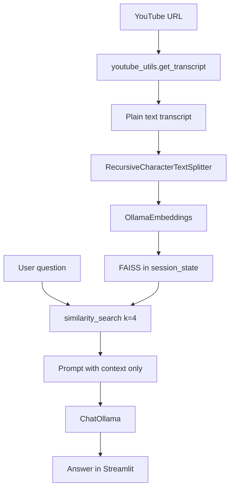

# YouTube RAG Bot

## Purpose

A **Streamlit** app that loads a **YouTube video transcript**, chunks and embeds it in **FAISS**, and answers user questions with **ChatOllama** using only retrieved context.

---

## Problem Statement

Learn from long video content by asking questions without watching the entire transcript manually, classic RAG over text obtained from YouTube captions.

---

## Features (Implemented)

- Parse YouTube URL to video ID (supports common URL formats).
- Fetch transcripts via **`youtube-transcript-api`** (prefers English, then Hindi, then first available track).
- Chunk transcript (`chunk_size=1000`, `overlap=150`), embed with **`nomic-embed-text`**, store in **in-memory FAISS**.
- Similarity search `k=4` and grounded answer generation.
- Session state keeps vector store after **Load Video**.

---

## Technologies and Architecture

| Component | Library / model |
|-----------|-----------------|
| UI | Streamlit |
| Transcripts | `youtube-transcript-api` |
| Embeddings | `OllamaEmbeddings` → `nomic-embed-text` |
| Vector store | `langchain_community.vectorstores.FAISS` |
| LLM | `ChatOllama` → `llama3.1:8b` |



---

## Project Structure

```text
YOUTUBE_RAG_Bot/
├── app.py              # Streamlit UI
├── rag.py              # create_vectorstore, ask_question
├── youtube_utils.py    # URL parsing + transcript fetch
└── requirements.txt    # Pinned dependency names (no versions)
```

---

## Prerequisites

- Ollama with `llama3.1:8b` and `nomic-embed-text`
- Python 3.10+
- Videos must expose captions/transcripts (auto-generated or manual)

---

## Installation and Setup

```bash
cd YOUTUBE_RAG_Bot
python -m venv .venv
# activate venv
pip install -r requirements.txt
pip install streamlit langchain-community faiss-cpu
ollama pull llama3.1:8b
ollama pull nomic-embed-text
```

`requirements.txt` lists core packages; **`streamlit`**, **`langchain-community`**, and **`faiss-cpu`** are required by the code but not all appear in that file, install as above.

---

## How to Run

```bash
cd YOUTUBE_RAG_Bot
streamlit run app.py
```

1. Paste a YouTube URL → **Load Video** (wait for transcript + indexing).
2. Enter a question → **Ask**.

Errors (invalid URL, missing transcript) display in Streamlit.

---

## Code Walkthrough

- **`get_video_id`**: regex handles `v=`, `youtu.be/`, and `/embed/` forms.
- **`create_vectorstore`**: single-string transcript split into `Document` chunks.
- **`ask_question`**: manual RAG prompt (not `create_retrieval_chain`), same pattern as [Advanced RAG](../AdvancedRAGConcepts/langchain_retriever.py).

---

## Example Usage

Use any public video with English (or available) captions. Questions should refer to content spoken in the video; unrelated questions should receive the “not available in the video” style response from the prompt.

---

## Troubleshooting and Limitations

- **No transcript**: Some videos block transcript API access or lack captions.
- **Language fallback**: Non-English transcripts may be used if English is unavailable, answers follow that text.
- **No video download**: Only transcript text is used, no visual understanding.
- **Rate limits**: YouTube or API changes can break transcript fetching; verify with a known-good URL.
- **Re-load required**: New URL requires clicking **Load Video** again.

---

## Related Learning Modules

- [Advanced RAG Concepts](../AdvancedRAGConcepts/README.md)
- [Vector Databases for RAG](../VectorDatabasesForRAG/README.md)

---

## Possible Future Improvements (Not in Repo)

- Persist FAISS index to disk per video ID.
- Show citation snippets with timestamps if transcript items include time codes.
- Summarization tab before Q&A.
